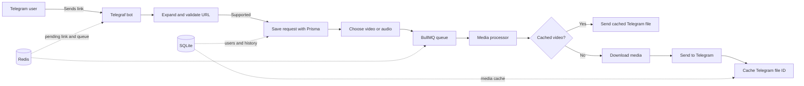

 <div align="center">

# Telegram Media Downloader Bot

### Send a social media link to Telegram and get the video back in chat.

Built with NestJS, Telegraf, BullMQ, Redis, and Prisma.


</div>

---

## What it does

Send a link from TikTok, Reddit, Instagram, or YouTube to the bot. The bot checks the URL, asks for a video or audio choice, and puts the request on a background queue. When processing finishes, the media is sent to the same Telegram chat.

The bot also records users and submitted links in SQLite, keeps pending links in Redis, and caches Telegram video file IDs so a previously processed video can be sent again without downloading it.

## How a request moves through the app



## Supported platforms

| Platform | Link handling |
| --- | --- |
| TikTok | Regular links and `vt.tiktok.com` short links |
| Reddit | `reddit.com` links |
| Instagram | `instagram.com` links |
| YouTube | Recognized by the validator |

The current bot reply lists TikTok, Reddit, and Instagram as supported. YouTube is recognized internally, but its end-to-end behavior has not been confirmed.

## Quick start

### 1. Install Docker

Install [Docker Desktop](https://www.docker.com/products/docker-desktop/) for Windows or macOS.

For Linux, install [Docker Engine and Docker Compose](https://docs.docker.com/engine/install/).

### 2. Download the project

1. Open the [repository](https://github.com/skywhycloud141/downloadtotg).
2. Click **Code → Download ZIP**.
3. Extract the archive and open the project folder.

### 3. Create a Telegram bot

1. Open [@BotFather](https://t.me/BotFather) in Telegram.
2. Send `/newbot` and follow the instructions.
3. Copy the token provided by BotFather.

### 4. Configure the environment

Create a file named `.env` inside the `backend` directory:

```dotenv
TELEGRAM_BOT_TOKEN=your-telegram-bot-token
DATABASE_URL=file:./dev.db
```

Replace `your-telegram-bot-token` with your actual token. Do not share this file or publish your token.

### 5. Configure Docker Compose

Open `docker-compose.yml` in the project root.

Under the `bot` service, add `env_file` at the same indentation level as `build`:

```yaml
    env_file:
      - ./backend/.env
```

Save the file.

### 6. Start the bot

Open a terminal in the project root, where `docker-compose.yml` is located, and run:

```bash
docker compose up --build -d
```

Check that the containers are running:

```bash
docker compose ps
```

### 7. Test the bot

Open your bot in Telegram and send:

```text
/start
```

Send a supported video link and follow the bot's instructions.

If the bot does not respond, check its logs:

```bash
docker compose logs -f bot
```

To stop the bot:

```bash
docker compose down
```

## Bot commands

| Command / message | What happens |
| --- | --- |
| `/start` | Creates or finds your user record and explains the link workflow |
| `/stats` | Shows recorded requests, grouped by platform |
| A supported URL | Validates and records the link, then offers format buttons |

## Architecture

| Component | Responsibility |
| --- | --- |
| NestJS + Telegraf | Telegram commands, messages, and callback buttons |
| Link validator | Resolves a URL host to a supported platform |
| BullMQ + Redis | Queues download jobs and stores short-lived pending links |
| Media processor | Downloads media, sends it to Telegram, and removes the temporary file |
| Prisma + SQLite | Stores Telegram users, request history, and cached Telegram file IDs |

## Project layout

```text
backend/
|-- prisma/                 # SQLite schema and migrations
`-- src/
    |-- bot/                 # Telegram commands and link workflow
    |-- link-validator/      # URL platform detection
    |-- media/               # BullMQ queue and media processor
    |-- prisma/              # Prisma client setup
    `-- user/                # Telegram user persistence
```

## Development

Run these commands from `backend/`:

```bash
npm run start:dev  # Start in watch mode
npm run build      # Compile the application
npm run lint       # Lint source and tests
npm test           # Run unit tests
npm run test:e2e   # Run end-to-end tests
```

## Current implementation notes

- The bot displays both video and audio options, but the current processor always downloads, sends, and caches video.
- `/stats` counts submitted supported links, not successful downloads.
- YouTube is detected by the link validator, but the user-facing unsupported-site message omits it.
- Docker Compose currently has no SQLite volume, so database data may be lost when the bot container is replaced.
