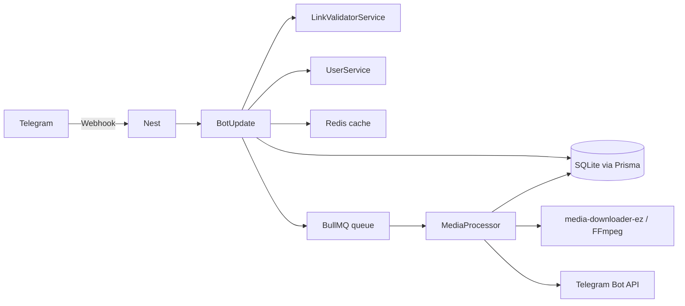
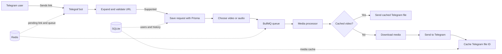

<<<<<<< ours
# Telegram Media Downloader Bot

Telegram-бот на NestJS принимает ссылки на публикации с поддерживаемых платформ, ставит обработку медиа в очередь BullMQ и отправляет результат в чат.

## Стек

- Node.js 24, TypeScript 6, NestJS 12.
- Telegraf и `nestjs-telegraf` для Telegram Bot API.
- BullMQ и Redis для фоновых заданий и временного состояния.
- Prisma 7 и SQLite для пользователей, истории запросов и кеша Telegram `file_id`.
- `media-downloader-ez` и FFmpeg для загрузки и обработки медиа.

## Архитектура

Приложение — один NestJS-процесс, который одновременно принимает Telegram webhook, подключается к Redis, обрабатывает очередь и работает с SQLite.



### Модули

| Модуль | Назначение |
| --- | --- |
| `src/bot` | Команды Telegram, приём ссылок, выбор формата и постановка задачи. |
| `src/link-validator` | Определение платформы по hostname ссылки. |
| `src/media` | Добавление задания в BullMQ и фоновая загрузка/отправка медиа. |
| `src/user` | Поиск и создание пользователя Telegram. |
| `src/prisma` | Инициализация Prisma Client с адаптером SQLite. |
| `src/app.module.ts` | Подключение модулей, Telegram webhook, Redis и конфигурации. |
| `src/main.ts` | Создание Nest-приложения и HTTP-сервера для webhook. |

Сценарий приложения сейчас реализован непосредственно в `BotUpdate`: он вызывает Redis, Prisma и очередь. Модули разделены по техническим компонентам, но отдельного application/domain слоя и портов для инфраструктуры нет.

## Поток запроса

1. Пользователь отправляет текстовую ссылку боту.
2. Бот проверяет, что строка является URL. Для текста, содержащего `tiktok.com`, выполняется запрос с переходом по редиректам.
3. `LinkValidatorService` сопоставляет hostname с платформой. Известны TikTok, Reddit, Instagram и YouTube.
4. Бот создаёт или находит пользователя, кладёт ссылку в Redis на пять минут и добавляет запись в `RequestHistory` со статусом `PENDING`.
5. Бот показывает кнопки «Видео» и «Аудио».
6. После выбора формата ссылка передаётся в очередь `download-queue` под именем задания `process-video`.
7. `MediaProcessor` проверяет кеш, загружает видео, отправляет его в Telegram и сохраняет полученный `file_id`. Временный файл удаляется после обработки.

## Данные

Схема находится в `backend/prisma/schema.prisma`; миграции — в `backend/prisma/migrations`.

| Модель | Содержимое |
| --- | --- |
| `User` | Telegram ID, имя пользователя и дата создания. Также содержит счётчики дневных загрузок, не используемые текущим потоком. |
| `RequestHistory` | URL, платформа, статус, время создания и связь с пользователем. |
| `MediaCache` | Уникальная пара исходный URL/формат и Telegram `file_id`. |

SQLite подключается через `DATABASE_URL`, например `file:./dev.db`. Redis используется и для очереди, и для временного состояния ожидающих ссылок.

## Настройка

Создайте `backend/.env`:

```dotenv
TELEGRAM_BOT_TOKEN=<токен от BotFather>
WEBHOOK_DOMAIN=<публичный HTTPS-домен webhook>
DATABASE_URL=file:./dev.db
PORT=3000
```

`PORT` необязателен; по умолчанию используется `3000`. Redis сейчас задан в `src/app.module.ts` как hostname `redis` и порт `6379`. Для локального запуска вне Docker этот hostname должен разрешаться в Redis.

Не добавляйте токен, cookies или другие секреты в Git. В текущем `backend/.dockerignore` исключён только `node_modules`, а Dockerfile копирует весь backend-каталог в образ. Перед сборкой образа необходимо исключить `.env` и `youtube-cookies.json` из Docker build context и передавать секреты при запуске контейнера.

## Локальный запуск

Требуются Node.js 24, npm, Redis и доступный Telegram Bot API. Для обработки медиа нужен FFmpeg.

```powershell
=======
<div align="center">

# Telegram Media Downloader Bot

### Send a social media link to Telegram and get the video back in chat.

Built with NestJS, Telegraf, BullMQ, Redis, and Prisma.


</div>

---

## What it does

Send a link from TikTok, Reddit, Instagram, or YouTube to the bot. The bot checks the URL, asks for a video or audio choice, and puts the request on a background queue. When processing finishes, the media is sent to the same Telegram chat.

The bot also records users and submitted links in SQLite, keeps pending links in Redis, and caches Telegram video file IDs so a previously processed video can be sent again without downloading it.

## How a request moves through the app



## Supported platforms

| Platform | Link handling |
| --- | --- |
| TikTok | Regular links and `vt.tiktok.com` short links |
| Reddit | `reddit.com` links |
| Instagram | `instagram.com` links |
| YouTube | Recognized by the validator |

The current bot reply lists TikTok, Reddit, and Instagram as supported. YouTube is recognized internally, but its end-to-end behavior has not been confirmed.

## Quick start

### Requirements

- Node.js 24 and npm
- Redis 7
- A Telegram bot token from [@BotFather](https://t.me/BotFather)
- FFmpeg for media processing (included in the Docker image)

### Configure the bot

Create `backend/.env`:

```dotenv
TELEGRAM_BOT_TOKEN=your-telegram-bot-token
DATABASE_URL=file:./dev.db

```

Keep this file private and out of version control.

### Run with Docker Compose

The application connects to Redis at `redis:6379`. Before starting Compose, pass the backend environment file to the `bot` service by adding this under `bot` in `docker-compose.yml`:

```yaml
    env_file:
      - ./backend/.env
```

Then start the services:

```bash
docker compose up --build
```

Compose starts Redis and the bot. The HTTP service listens on port `3000`; the bot receives messages through the Telegram Bot API. The current Compose setup does not persist the SQLite database across container replacement.

### Run locally

The backend currently uses the Redis hostname `redis` for both BullMQ and its link cache. Run Redis with that hostname reachable from your backend, or change the Redis host in `backend/src/app.module.ts` to match your local Redis instance.

From the repository root:

```bash
>>>>>>> theirs
cd backend
npm ci --legacy-peer-deps
npx prisma generate
npx prisma migrate deploy
npm run start:dev
```

<<<<<<< ours
Перед запуском убедитесь, что Redis доступен по адресу `redis:6379` либо настройте этот адрес в приложении. Nest слушает `PORT` или порт `3000`. Telegram webhook настраивается через `WEBHOOK_DOMAIN`; путь обработчика — `/telegraf/secret-webhook`.

## Docker Compose

Compose описывает Redis и контейнер бота:

```powershell
docker compose up --build
```

Текущая конфигурация Compose не задаёт `env_file` для сервиса `bot`, не проверяет готовность Redis и не подключает постоянный том для SQLite. Для рабочего запуска нужно передать переменные окружения контейнеру и обеспечить постоянное хранение файла БД. Текущая сборка также может включить `.env` и `youtube-cookies.json` в образ, так как Dockerfile выполняет `COPY . .`, а `.dockerignore` их не исключает.

## Telegram-команды и интерфейс

| Ввод | Поведение |
| --- | --- |
| `/start` | Создаёт пользователя при необходимости и объясняет сценарий. |
| `/stats` | Показывает число записей истории и группировку по платформе. |
| URL | Проверяет платформу, сохраняет запрос и предлагает формат. |

Сервис распознаёт `tiktok.com`, `vt.tiktok.com`, `reddit.com`, `instagram.com`, `youtube.com` и `youtu.be` в перечисленных в коде вариантах hostname.

## Ограничения текущей реализации

- Выбор «Аудио» принимается интерфейсом, но обработчик очереди загружает и отправляет только видео; формат в типе задания не описан и не используется.
- Записи запросов остаются со статусом `PENDING`; статистика считает отправленные ссылки, а не успешные загрузки.
- Ожидающая ссылка хранится под ключом с Telegram user ID. Несколько одновременно ожидающих кнопок у одного пользователя могут обратиться к последней сохранённой ссылке.
- YouTube распознаётся валидатором, но фактическая загрузка для него не гарантирована.
- Раскрытие короткой ссылки выполняет сетевой запрос до окончательной проверки платформы. При развёртывании необходимо ограничить допустимые адреса и редиректы, чтобы исключить обращения к внутренним ресурсам.
- Загрузка, Telegram-отправка и запись кеша не объединены транзакцией и не защищены общей идемпотентностью. Повтор задания может повторно отправить файл.
- Redis host/port заданы в исходном коде, а не вынесены в конфигурацию.
- HTTP-порт используется для webhook. `AppController` с маршрутом `GET /` не подключён в `AppModule`.
- В Compose отсутствуют healthcheck, постоянный том SQLite и явная передача `env_file`.

## Разработка и проверки

Команды запускаются из `backend/`:

```powershell
npm run build
npm run lint
npm test
npm run test:e2e
```

`test:e2e` содержит стартовую проверку `GET /`, ожидающую `Hello World!`; этот маршрут сейчас не подключён в `AppModule`, поэтому тест и фактический HTTP-контракт расходятся.
=======
Message `/start` to your bot, then send a supported link and choose a format.

## Bot commands

| Command / message | What happens |
| --- | --- |
| `/start` | Creates or finds your user record and explains the link workflow |
| `/stats` | Shows recorded requests, grouped by platform |
| A supported URL | Validates and records the link, then offers format buttons |

## Architecture

| Component | Responsibility |
| --- | --- |
| NestJS + Telegraf | Telegram commands, messages, and callback buttons |
| Link validator | Resolves a URL host to a supported platform |
| BullMQ + Redis | Queues download jobs and stores short-lived pending links |
| Media processor | Downloads media, sends it to Telegram, and removes the temporary file |
| Prisma + SQLite | Stores Telegram users, request history, and cached Telegram file IDs |

## Project layout

```text
backend/
|-- prisma/                 # SQLite schema and migrations
`-- src/
    |-- bot/                 # Telegram commands and link workflow
    |-- link-validator/      # URL platform detection
    |-- media/               # BullMQ queue and media processor
    |-- prisma/              # Prisma client setup
    `-- user/                # Telegram user persistence
```

## Development

Run these commands from `backend/`:

```bash
npm run start:dev  # Start in watch mode
npm run build      # Compile the application
npm run lint       # Lint source and tests
npm test           # Run unit tests
npm run test:e2e   # Run end-to-end tests
```

## Current implementation notes

- The bot displays both video and audio options, but the current processor always downloads, sends, and caches video.
- `/stats` counts submitted supported links, not successful downloads.
- YouTube is detected by the link validator, but the user-facing unsupported-site message omits it.
- Docker Compose currently has no SQLite volume, so database data may be lost when the bot container is replaced.
>>>>>>> theirs
